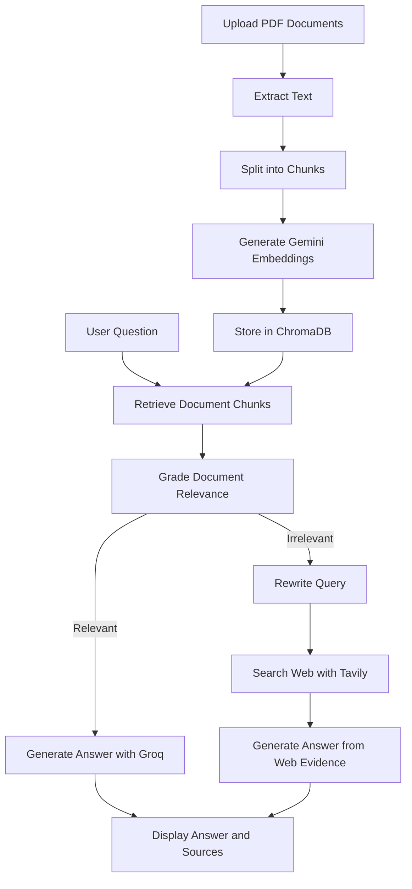

# 🔎 Corrective RAG — Intelligent Document Q&A with Web Fallback

A **Corrective Retrieval-Augmented Generation (CRAG)** application that answers questions from uploaded PDF documents and falls back to web search when the retrieved document content is not relevant.

Built with Streamlit, LangChain, Gemini Embeddings, ChromaDB, Groq, and Tavily.

---
## 🚀 Live Demo

**[🔎 Try Corrective RAG Live](https://corrective-rag-a4wr7cy5xd8bbmmwuvfrpy.streamlit.app/)**

Explore document-based question answering with relevance grading, query rewriting, and web-search fallback.

**[💻 View Source Code on GitHub](https://github.com/kryptoadi/corrective-rag)**

---

## ✨ Overview

Traditional RAG systems retrieve relevant chunks from a knowledge base and use them to generate answers. However, retrieved chunks may not always contain the information needed to answer a question.

This project introduces a corrective retrieval workflow that evaluates retrieved documents before generating an answer.

When relevant information is found in the uploaded PDFs, the application generates an answer using that content. When the retrieved chunks are irrelevant, it rewrites the query and searches the web using Tavily.

## 🚀 Features

- 📄 **Multi-PDF Upload:** Upload multiple PDF documents in one session.
- ✂️ **Document Chunking:** Split extracted text into manageable chunks with overlapping context.
- 🧠 **Gemini Embeddings:** Convert document chunks into vector representations using Gemini Embedding 2.
- 🗄️ **Vector Storage:** Store and retrieve document chunks using ChromaDB.
- 🔍 **Semantic Retrieval:** Retrieve relevant chunks using similarity search with Maximal Marginal Relevance (MMR).
- ✅ **Relevance Grading:** Use an LLM to determine whether retrieved chunks are useful for answering a question.
- 🔄 **Query Rewriting:** Rewrite questions to improve web-search queries when document retrieval fails.
- 🌐 **Web Search Fallback:** Use Tavily to find external information when the uploaded documents lack relevant evidence.
- 💬 **Answer Generation:** Generate responses with Groq using retrieved document or web evidence.
- 📚 **Source Display:** Display document metadata or web links alongside answers.
- 🖥️ **Interactive UI:** Use the application through a Streamlit interface.

## 🏗️ Architecture



## 🛠️ Tech Stack

| Technology         | Purpose                                               |
| ------------------ | ----------------------------------------------------- |
| Python             | Application logic                                     |
| Streamlit          | Interactive web interface                             |
| LangChain          | Document processing and LLM integration               |
| Gemini Embedding 2 | Document embeddings                                   |
| ChromaDB           | Vector database                                       |
| Groq               | LLM inference, relevance grading, and query rewriting |
| Tavily             | Web search fallback                                   |
| PyPDFLoader        | PDF text extraction                                   |

## ⚙️ How It Works

### 1. Upload and process documents

Upload one or more PDFs through the Streamlit interface. The application extracts the pages, splits their text into overlapping chunks, generates embeddings, and stores the chunks in ChromaDB.

### 2. Retrieve relevant chunks

When a question is submitted, the application searches the vector database for candidate chunks. MMR retrieval helps reduce redundancy among the selected chunks.

### 3. Grade document relevance

Groq evaluates the retrieved chunks and classifies them as `RELEVANT` or `IRRELEVANT`.

### 4. Generate an answer from documents

If relevant chunks are found, Groq generates an answer using the retrieved document evidence.

### 5. Rewrite the query and search the web

If no relevant document chunks are found, the application rewrites the question into a search query and sends it to Tavily.

### 6. Generate an answer from web results

Groq uses the returned web-search content to generate an answer, and the application displays the available source links.

## 📦 Installation

### Prerequisites

- Python 3.10 or a compatible version supported by your installed dependencies
- A Gemini API key
- A Groq API key
- A Tavily API key

### 1. Clone the repository

```bash
git clone https://github.com/kryptoadi/corrective-rag.git
cd corrective-rag
```

Replace `YOUR_USERNAME` with your GitHub username.

### 2. Create a virtual environment

**Windows:**

```bash
python -m venv venv
venv\Scripts\activate
```

**macOS/Linux:**

```bash
python3 -m venv venv
source venv/bin/activate
```

### 3. Install dependencies

```bash
pip install -r requirements.txt
```

### 4. Configure API keys

The application accepts API keys through the Streamlit sidebar:

- **Gemini API Key:** Used to generate document embeddings.
- **Groq API Key:** Used for relevance grading, query rewriting, and answer generation.
- **Tavily API Key:** Used for web-search fallback.

Obtain keys from the respective providers:

- [Google AI Studio](https://aistudio.google.com/)
- [Groq Console](https://console.groq.com/)
- [Tavily](https://tavily.com/)

Keep your API keys private. Never commit secrets to GitHub.

### 5. Run the application

```bash
streamlit run app.py
```

Open the local URL displayed in your terminal, usually `http://localhost:8501`.

## 💡 Example Questions

Try these after uploading your PDFs:

| Question                                          | Expected behavior                                                                   |
| ------------------------------------------------- | ----------------------------------------------------------------------------------- |
| What is the company's leave policy?               | Answer from relevant PDF content, if available                                      |
| What are the reporting definitions?               | Retrieve and answer from the uploaded documents, if relevant chunks are found       |
| What is quantum computing?                        | Use web fallback if the PDFs contain no relevant chunks                             |
| What are the latest developments in a technology? | Attempt document retrieval first, then web fallback if no relevant chunks are found |

Actual results depend on the uploaded documents and the quality of the retrieved evidence and web-search results.

## 🔐 Security and Privacy

- Enter API keys through the application's password fields.
- Do not commit `.env` files or Streamlit secrets to version control.
- Uploaded PDFs are processed by the application and their text is sent to the configured embedding or language-model providers as needed.
- Web fallback sends the rewritten search query to Tavily.
- Review provider data-handling policies before using confidential documents.
- The local ChromaDB directory may contain extracted document content and embeddings; keep it out of public repositories.

## ⚠️ Current Limitations

- The application currently supports PDF documents.
- PDF extraction may not work correctly for scanned documents that require OCR.
- Relevance grading depends on LLM judgments and may occasionally misclassify chunks.
- Web-search results are used as returned by Tavily; the current implementation does not independently grade every web result before answer generation.
- Answers may be incomplete if retrieved evidence is insufficient.
- The application should not be treated as a substitute for verifying important information against its original sources.

## 🔮 Future Improvements

- [ ] Grade web-search results for relevance.
- [ ] Add retries when retrieved evidence is insufficient.
- [ ] Add support for DOCX, TXT, and other document formats.
- [ ] Add conversation history and follow-up questions.
- [ ] Add configurable retrieval parameters.
- [ ] Improve duplicate-document and vector-store management.
- [ ] Add automated evaluation for retrieval quality and answer faithfulness.
- [ ] Add OCR support for scanned PDFs.

## 🎯 Learning Outcomes

This project demonstrates practical experience with:

- Retrieval-Augmented Generation (RAG)
- Corrective retrieval workflows
- Vector embeddings and vector databases
- Semantic search and MMR retrieval
- LLM-based relevance grading
- Query rewriting
- Tool and API integration
- Source-aware answer generation
- Building and deploying GenAI applications with Streamlit

## 🤝 Contributing

Suggestions, bug reports, and improvements are welcome. Feel free to fork the repository and submit a pull request.

## 📄 License

This project is available under the MIT License if you choose to include one. Add a `LICENSE` file to the repository before describing it as MIT-licensed.

---

**Built as a hands-on project exploring reliable retrieval and web-grounded question answering with Generative AI.**
